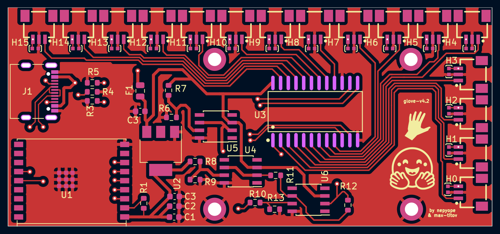
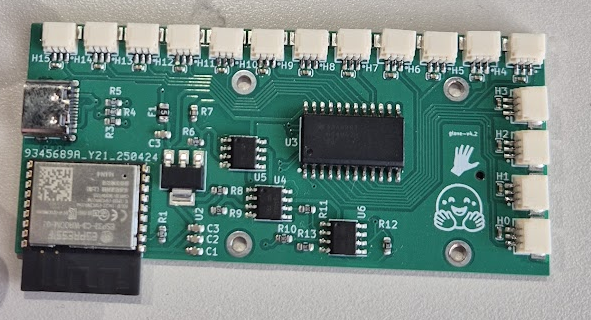

# Homunculus Glove PCB

The sensor board for the Homunculus glove: an 80 × 36 mm two-layer board (glove-v4.2). Each of the 16 JST SH 3-pin
connectors (`H0`–`H15`) takes one Hall sensor. They feed a CD74HC4067 16-channel analog mux (`U3`) that the
ESP32-C3-WROOM-02 (`U1`) switches and samples. It's powered from USB-C (`J1`) through a fuse and an AMS1117-3.3
regulator (`U2`), and three OPA340 op-amps (`U4`–`U6`) sit in the analog path to the ADC.

## The PCB

The KiCad project is in [`./pcb`](./pcb): open `desk_display.kicad_pro` (schematic + layout, custom footprints in
`lib/`). Gerbers, BOM and pick-and-place files for ordering are one level up, in [`../`](../).

## The Code

[`code.ino`](./code.ino) is a minimal test sketch: it steps the mux through all 16 channels and prints the raw 12-bit
readings over serial at 115200 baud. The [`./code`](./code) PlatformIO project is a leftover from the board this
project started from and doesn't target the glove.

## License

`CERN OHL v2 Permissive`, see [`LICENSE`](./LICENSE).
